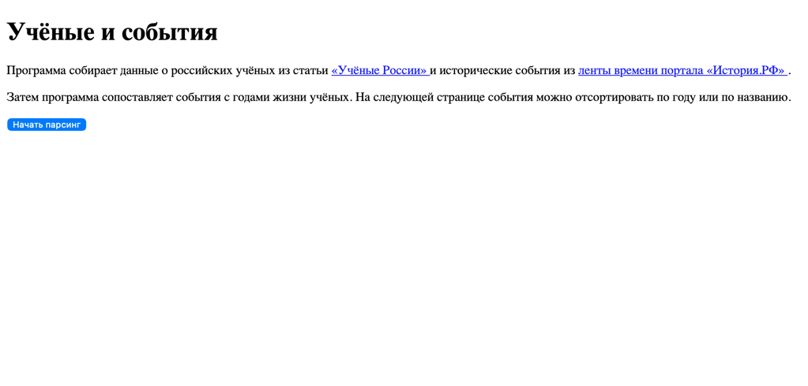
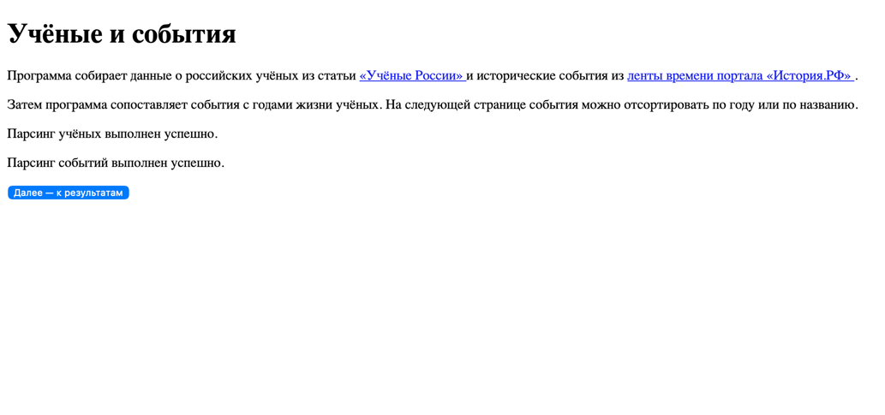
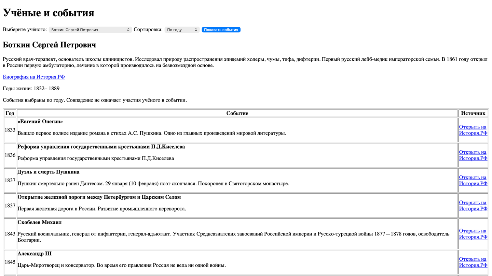

# Учёные и исторические события

Приложение собирает информацию об учёных и исторические записи с портала История.РФ. Затем оно показывает записи, относящиеся к годам жизни выбранного учёного.

На странице можно прочитать краткую биографию, посмотреть список событий и отсортировать его по году или названию.

## Возможности

- Сбор сведений об учёных из статьи Учёные России.
- Сбор исторических записей из ленты времени за 18, 19 и 20 века.
- Сохранение полученных данных в PostgreSQL.
- Обновление ранее сохранённых записей при повторном сборе.
- Просмотр биографии учёного и событий его времени.
- Переход к исходным материалам.

## Технологии

Проект написан на **Java 21** с использованием **Spring Boot**. Для работы с базой применяются Spring JDBC и SQL-запросы, для страниц - Thymeleaf, для сбора данных - Selenium.

PostgreSQL запускается в Docker. Зависимостями проекта управляет Maven.

## Что установить перед запуском

- Git
- JDK 21
- Docker с поддержкой Docker Compose
- Google Chrome
- IntelliJ IDEA или другую среду разработки для Java

## Как запустить проект

Команды ниже подходят для **macOS, Linux и Windows**. В Windows их можно выполнять в PowerShell.

### 1. Скачать проект

Откройте терминал и выполните:

```bash
git clone https://github.com/TimofeySD/Parser
```

Перейдите в папку проекта:

```bash
cd Parser
```

Если при клонировании вы выбрали другое имя папки, используйте его вместо `Parser`.

### 2. Запустить PostgreSQL

Скачайте Docker Desktop и откройте его. Затем в терминале, находясь в папке проекта, выполните:

```bash
docker compose up -d
```

При первом запуске Docker скачает образ PostgreSQL и создаст контейнер с пустой базой.

Проверьте, что контейнер работает:

```bash
docker compose ps
```

В списке должен отображаться запущенный сервис `postgres`. Приложение подключается к базе через локальный порт `5433`.

### 3. Открыть проект в IntelliJ IDEA

1. Выберите **Open** и откройте скачанную папку проекта.
2. Дождитесь, пока IDEA загрузит Maven-зависимости.
3. Проверьте, что для проекта выбрана **JDK 21**.

### 4. Запустить приложение

Откройте класс `ParserApplication` и запустите его метод `main`.

Приложение подключится к PostgreSQL и создаст таблицы, если их ещё нет.

### 5. Собрать данные

Откройте в браузере:

```text
http://localhost:8080/
```

Нажмите **Начать парсинг**. Приложение по очереди соберёт данные об учёных и исторических событиях. Во время работы Selenium откроет Chrome.

Когда оба импорта завершатся, нажмите **Далее - к результатам**.

### 6. Посмотреть результаты

Выберите учёного и способ сортировки, затем нажмите **Показать события**. На странице появятся биография и исторические записи, относящиеся к периоду его жизни.

## Источники

- [Учёные России](https://history.ru/read/articles/uchenye-rossii)
- [Лента времени портала История.РФ](https://history.ru/timeline)

У записей на странице приложения есть ссылки на исходные материалы.

## Структура проекта

Проект разделён на несколько частей:

- `controller` - обработка запросов и переходов между страницами;
- `service` - управление сбором, сохранением и получением данных;
- `scraper` - чтение страниц сайта с помощью Selenium;
- `repository` - SQL-запросы к базе;
- `model` - модели учёных и исторических записей.

## Остановка и очистка базы

Чтобы остановить контейнер, сохранив данные:

```bash
docker compose down
```

Чтобы снова его запустить:

```bash
docker compose up -d
```

Чтобы остановить контейнер **и удалить том со всеми данными PostgreSQL**:

```bash
docker compose down -v
```

Чтобы вернуться на стартовую страницу нужно снова перейти по адресу:

```text
http://localhost:8080/
```

## Скриншоты

Стартовая страница:



Страница успешного парсинга:



Страница результатов:

